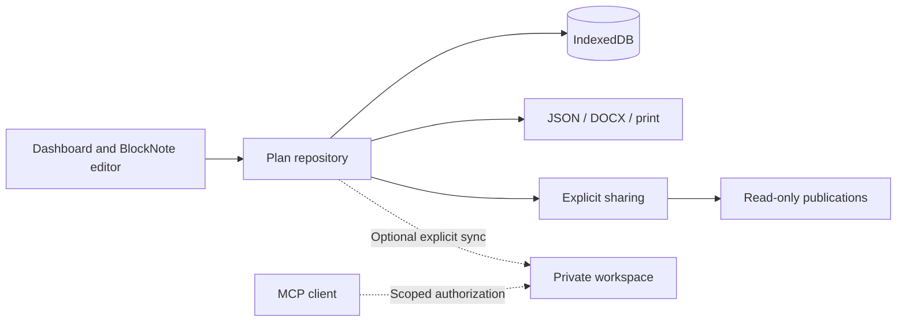

# IPOS.Plan

**Local-first editorial planning workspace for media teams.**

Create production briefs, organize assignments and deadlines, edit structured documents, maintain revisions, and publish or export plans without requiring a cloud account for ordinary editing.

[Live application](https://ipos-plan.vercel.app) · [Architecture](docs/ARCHITECTURE.md) · [CI runs](https://github.com/Human-Unit/IPOS.Plan/actions) · [Русская документация](docs/README.ru.md)

[](https://github.com/Human-Unit/IPOS.Plan/actions/workflows/validate.yml)

## Product overview

- Dashboard with search, filters, progress and recent activity.
- Block-based editor for production briefs, tasks, references and media.
- Local autosave, revision history, recovery and portable JSON backups.
- Read-only snapshots, named publications, editable DOCX export and A4 printing.
- Optional private workspace synchronization and MCP integration, subject to separate configuration and acceptance.

## Architecture



**Stack:** Next.js 16, React 19, TypeScript, BlockNote, Dexie / IndexedDB, Zod, Vercel Blob, MCP SDK, Vitest and Playwright.

### Engineering decisions

| Decision | Rationale |
| --- | --- |
| Local-first persistence | Ordinary documents remain in the browser; cloud transfer is explicit. |
| Transactional version checks | Prevent silent overwrites from competing tabs and support recoverable imports. |
| Portable schema | Keep document interchange independent of local database metadata. |
| Shared rendering model | Reuse validated document structures across editing, preview and sharing. |
| Separate publication and private sync | Keep public snapshots distinct from authorized workspace access. |
| Bounded input validation | Validate imported documents and enforce size limits before processing. |

## Run locally

Requires Node.js 24.x and npm.

```sh
npm ci
npm run dev
```

Open http://127.0.0.1:3105. Ordinary local editing needs no server credentials. Use synthetic content for evaluation; browser storage is origin-specific.

For a production-like local build:

```sh
npm run build
npm start
```

## Quality and reproducibility

```sh
npm run lint
npm run typecheck
npm test
npm run mcp:preflight:test
npm run build
npx playwright install chromium
npm run test:e2e
```

A [verified successful main-branch CI run](https://github.com/Human-Unit/IPOS.Plan/actions/runs/45599869611) at commit `fe5fb140` passed lint, type checking, unit tests, MCP preflight tests, independent DOCX ZIP/OOXML validation, production build and Chromium browser checks. This is historical evidence for that commit, not a guarantee for every subsequent revision. See the live badge and Actions for current results.

## Repository guide

| Path | Responsibility |
| --- | --- |
| `src/app` | Routes, layouts and server endpoints |
| `src/components/editor` | BlockNote editor, briefs and inspector |
| `src/features/plans` | Dashboard, persistence and autosave |
| `src/features/sharing` | Read-only snapshots and publications |
| `src/features/export`, `src/features/backup` | Document export and backups |
| `src/lib/db`, `src/lib/schema` | Local persistence and validation |
| `src/lib/ai-workspace` | Private workspace authorization and MCP |
| `tests` | Unit and browser verification |

## Security and current boundaries

This is a local-first, single-owner workspace, not a multi-tenant SaaS. Browser storage is not a substitute for backups. Share links are not access-control credentials. Optional private synchronization and MCP require configured private storage, owner OAuth and end-to-end acceptance; mocked tests do not prove live connectivity. Keep all credentials outside Git and use isolated test data.

See [Russian setup and environment documentation](docs/README.ru.md), [MCP setup](docs/CHATGPT_MCP.md), [portable schema](docs/PLAN_SCHEMA.md) and [architecture](docs/ARCHITECTURE.md).

## Design and development

Historical design iterations and responsive screenshots are available in [design documentation](docs/design). They represent earlier revisions, not necessarily the current deployment.

Use focused branches and pull requests, verify CI and preview deployments before merging, and preserve compatibility with existing documents. No license grant is implied by public repository visibility.
